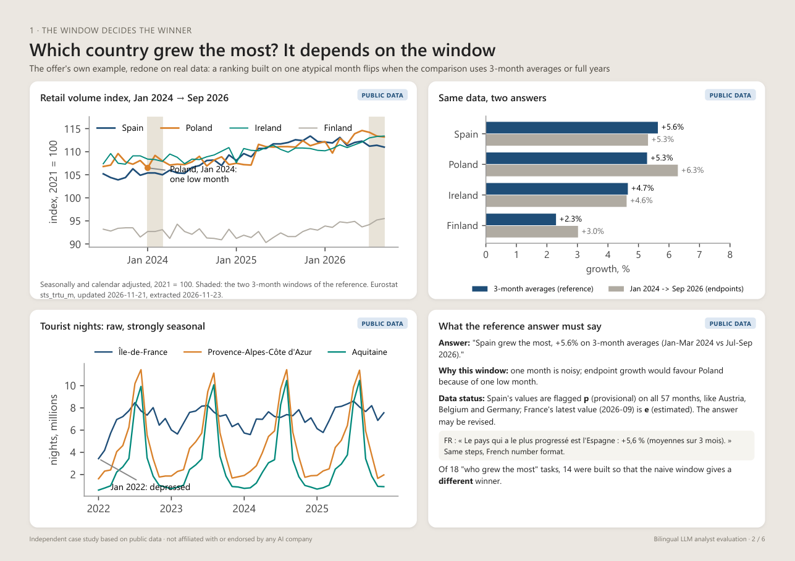

# Where language models slip on analyst questions: a bilingual gold set and grading rubric

### 📄 [Read the report (PDF, 6 pages)](https://albt-france.github.io/bilingual-llm-analyst-eval-case-study/report/LLM_analyst_eval.pdf) · 🖥️ [Open the live dashboard](https://albt-france.github.io/bilingual-llm-analyst-eval-case-study/dashboard/)

An independent case study for an AI-training analyst role: writing analytical questions and scenarios, computing
the right answer, explaining it step by step, checking claims against primary sources, chunking long texts, and
grading model answers, **in English and in French**.

- **Report (6 pages):** [report/LLM_analyst_eval.pdf](report/LLM_analyst_eval.pdf)
- **Evaluation workbook (main tool):** [eval/llm_eval_workbook.xlsx](eval/llm_eval_workbook.xlsx), 7 tabs: README,
  Gold set, Rubric, Error taxonomy, Review log (with blind-test columns), Agreement, Summary (formulas + native charts)
- **Gold set:** [eval/gold_set.jsonl](eval/gold_set.jsonl), 240 lines (120 tasks x EN/FR): prompt, reference answer,
  step-by-step explanation, source and series code, data status, how it was verified
- **Guides:** [writing a gold answer](docs/writing_a_gold_answer.md) · [rubric](docs/rubric.md) ·
  [error taxonomy, with French-specific pitfalls](docs/error_taxonomy.md) · [claim-checking method](docs/claim_checking_method.md) ·
  [chunking guide](docs/chunking_guide.md) · [data issues log](docs/data_issues_log.md)
- **Dashboard source (self-contained HTML, 5 tabs incl. a searchable gold-set browser):** [dashboard/index.html](dashboard/index.html), also works offline
- **Notebook (executed):** [notebooks/llm_analyst_eval.ipynb](notebooks/llm_analyst_eval.ipynb)

**PUBLIC DATA** (Eurostat, INSEE, Wikipedia) for the tasks and reference answers. **SIMULATED** for the model answers
and the reviewers: no real language model was called and no answer is attributed to any product.

## Key results

1. **The window decides the winner.** On real Eurostat retail data, "which country grew the most between January 2024
   and September 2026?" gives Poland (+6.3%) with endpoint growth and Spain (+5.6%) with 3-month averages: one
   atypical month flips the ranking. 14 of the 18 "who grew the most" tasks are built so that the naive window gives a
   different winner.
2. **The number can match and still be wrong.** Three of the first series reached for were stopped or frozen
   (INSEE CPI base 2015 excluding tobacco, INSEE unemployment for metropolitan France, Eurostat `prc_hicp_manr`), and
   recent Eurostat retail values are flagged provisional (`p`) or estimated (`e`). Each became a claim-checking task
   and a rubric rule.
3. **Where the simulated model slips:** method more than arithmetic: broken puzzle rules, data status presented as
   final, wrong comparison windows, % instead of percentage points. Every puzzle answer is re-checked by a
   brute-force solver.
4. **"Worse in French" is a false signal.** The raw pass rate is 10 points lower in French (54% vs 64%), but French
   items were rated hard far more often (45% vs 24%). At equal difficulty the gap is within 2 points and standardised
   rates are equal. What differs is the kind of error (decimal comma, milliard vs billion, trimestre vs semestre).
   Reviewer agreement rose from kappa 0.59 to 0.87 once the grey zones had written rules.



## Methods

- **Tasks (120, each in EN and FR):** 40 series analyses (Eurostat retail volume, tourist nights, HICP,
  unemployment), 30 courier-route logic puzzles, 25 claim checks (Eurostat, INSEE), 25 summarising and chunking tasks
  (5 Wikipedia articles at fixed revisions). French versions are written for a French reader, not translated word for word.
- **Reference answers:** computed from the public extracts (`src/build_series_tasks.py`), re-verified in the notebook
  (DuckDB SQL for growth questions, brute-force solver for puzzles, number check for summaries). The five lead
  summaries are hand-written; every figure in them is checked against the source.
- **Simulated part:** a fictional model whose outcome depends on item difficulty only (seed 42), with planted errors
  built from the same numbers; 3 simulated reviewers grade every answer with guidelines v1, then v2. Eight hidden
  events (seven issues, one false signal) are checked against an answer key opened last.
- **Analysis:** DuckDB SQL `sql/01_load.sql` to `sql/05_reviewer_agreement.sql` (consensus, pass rates, error codes,
  language gap raw and stratified, Cohen's kappa).
- AI-assisted workflow: I used Claude, mainly to write scripts faster. I drove the project: I defined the questions, chose and validated the data sources, made the analytical decisions and checked every result.

## How to re-run

```
pip install -r requirements.txt
python src/fetch_public.py
python src/build_series_tasks.py
python src/puzzle_solver.py
python src/simulate_model.py
python src/run_sql.py
python src/build_workbook.py
jupyter nbconvert --to notebook --execute --inplace notebooks/llm_analyst_eval.ipynb
python src/build_pdf.py
python src/build_dashboard.py
```

Run from the repository root (Windows; the PDF step uses Microsoft Edge headless). `fetch_public.py` calls official
APIs at most once per second and caches raw responses in `data/raw/` (not published). `simulate_model.py` also writes
the answer key `data/_hidden_truth*.csv` locally (not published).

## Sources and licences (extracted 2026-11-23)

| Source | Codes | Licence |
|---|---|---|
| Eurostat dissemination API | `sts_trtu_m` (updated 2026-11-21), `tour_occ_nin2m` (2026-10-20), `prc_hicp_minr`, `prc_hicp_manr` (frozen at 2025-12), `une_rt_m` | Eurostat reuse policy: free reuse with the source acknowledged |
| INSEE BDM (SDMX) | 011814630 (CPI base 2025), 001763852 (CPI base 2015, stopped), 001688527 (unemployment), 001688526 (stopped) | Licence Ouverte / Etalab 2.0 |
| Wikipedia | "Eurostat" (oldid 1356128040), "Consumer price index" (1385974709), "Seasonal adjustment" (1356584187), "Institut national de la statistique et des études économiques" (241378467), "Nomenclature des unités territoriales statistiques" (229375657) | CC BY-SA 4.0; only short excerpts and our own summaries are published |

Values flagged `p` (provisional) or `e` (estimated) are labelled as such and may be revised.

## Limits

- The model and the reviewers are simulated: error rates and kappa values illustrate the method and measure nothing real.
- Errors and checks were designed together, so detection is optimistic.
- Item difficulty is a writer's rating, not a measured property.
- Eurostat values may be revised after the extraction date; a re-run fetches current data, and Wikipedia texts are
  fetched at their current revision (the script warns if it differs from the one used here).

---
Independent case study based on public data · not affiliated with or endorsed by any AI company
